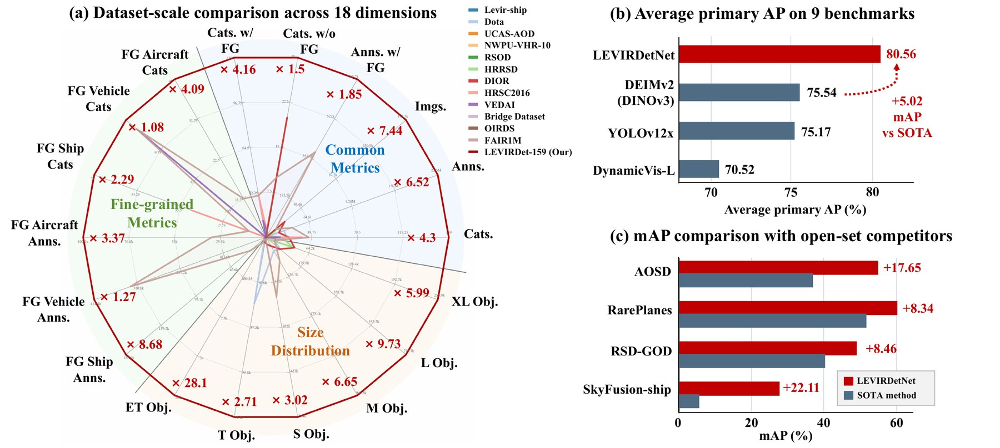
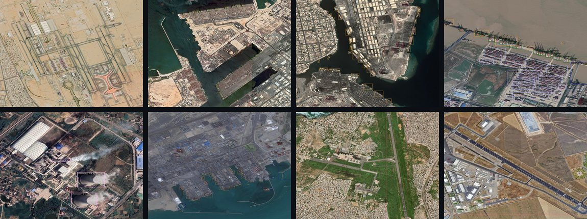
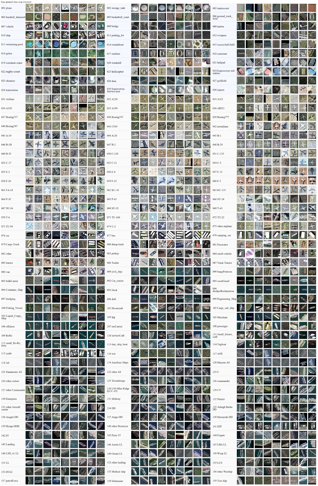
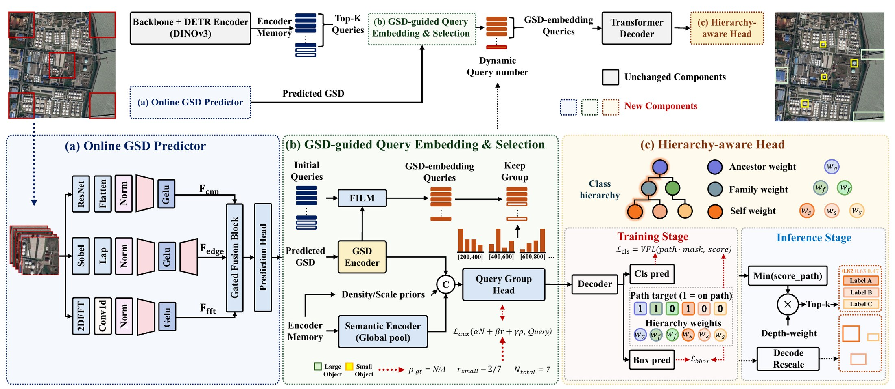
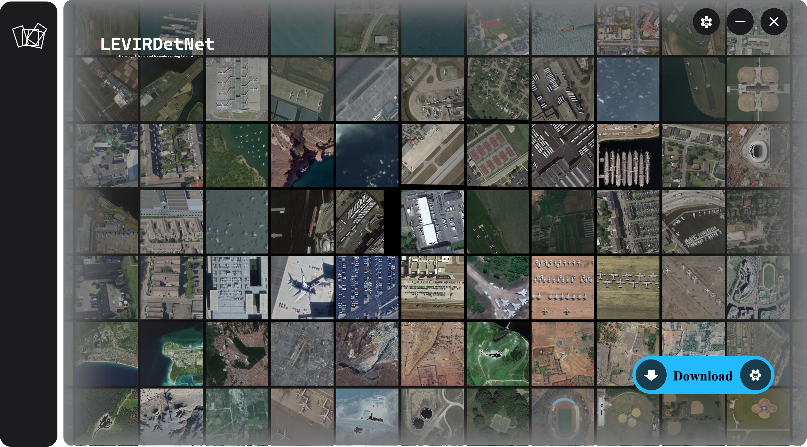

# LEVIRDet-release

**A Million-Scale 159-Category Dataset and Foundation Model for Universal Remote Sensing Object Detection**

[](https://qinzheyang.github.io/LEVIRDet/)
[](https://qinzheyang.github.io/LEVIRDet/levir-demo/)
[](https://arxiv.org/abs/2606.25312)
[](#release-status)

> **Release notice.**
> 🌟🌟🌟 The LEVIRDet dataset, trained models and their weights, as well as the Docker, are now **fully available**.

Download **Docker Environment for model** from either mirror:

| Mirror | Download | Access code |
| --- | --- | --- |
| Baidu Netdisk | [Download Docker image](https://pan.baidu.com/s/1o34wKHJEy7mUhm6Gpnapag?pwd=pzic) | `pzic` |
| Google Drive | [Download Docker image](https://drive.google.com/file/d/1h76qWD5WfomQUXoQWGxFZs6R_QCl64ei/view?usp=sharing) | — |
| Huggingface | [Download Docker image](https://huggingface.co/yangqinzhe/LEVIRDetNet/tree/main) | — |
| ModelScope | [Download Trained Model(30 and 159 class)](https://www.modelscope.cn/models/yangqinzhe/LEVIRDetNet) | — |

Download **model check point** from either mirror:

| Mirror | Download | Access code |
| --- | --- | --- |
| Baidu Netdisk | [Download Trained Model(30 and 159 class)](https://pan.baidu.com/s/1i6EOvclCBwuYEJxy2uFaKg?pwd=wf66) | `wf66` |
| Google Drive | [Download Trained Model(30 class)](https://drive.google.com/file/d/1G-WIA44hUVPjEjEPOHcm3OP2qh7jUIde/view?usp=drive_link)  and  [Download Trained Model(159 class)](https://drive.google.com/file/d/1lLIrXkpyDi0gJHCvjHKffYupr2Eq8UGG/view?usp=drive_link)| — |
| Huggingface | [Download Trained Model(30 and 159 class)](https://huggingface.co/yangqinzhe/LEVIRDetNet/tree/main) | — |
| ModelScope | [Download Trained Model(30 and 159 class)](https://www.modelscope.cn/models/yangqinzhe/LEVIRDetNet) | — |

Download **LEVIRDet-159 Dataset** from either mirror:

| Version | Image format | Hugging Face | ModelScope | Baidu Netdisk | Access code | Google Drive | Size |
| --- | --- | --- | --- | --- | --- | --- | --- |
| Original-image release | Original image bytes; seven-digit filenames | [Download](https://huggingface.co/datasets/yangqinzhe/LEVIRDet-159-Dataset) | [Download](https://www.modelscope.cn/datasets/yangqinzhe/LEVIRDet-159-Dataset) |  [Download](https://pan.baidu.com/s/1RJAQyswyPzbNF6w-67Eo8g?pwd=3fj4)  | 3fj4 | — | ~ 130G |
| Lightweight release | JPEG quality 95; unchanged dimensions | [Download](https://huggingface.co/datasets/yangqinzhe/LEVIRDet-159-Dataset) | [Download](https://www.modelscope.cn/datasets/yangqinzhe/LEVIRDet-159-Dataset) | [Download](https://pan.baidu.com/s/1WC2GLhpx637uiq0FlFVL8A?pwd=t3yy) | t3yy | — | ~ 50G |

[**I have download. How to use?**](#Installation)

[**I don not like codes. I only what to use it like app?**](#Use-LEVIRDetNet-in-the-same-way-as-an-APP)

## Table of Contents

- [Overview and Performance](#Overview-and-Performance)
  - [Demo](#Demo)
  - [Overview and Highlights](#Overview-and-Highlights)
  - [Update Log](#Update-Log)
  - [Dataset Scale](#Dataset-Scale)
  - [LEVIRDetNet](#LEVIRDetNet)
  - [Target-Training-Free Benchmark Results](#Target-Training-Free-Benchmark-Results)
- [Release Status](#Release-Status)
- [Installation](#Installation)
  - [Getting Started](#Getting-Started)
  - [Dependencies](#Dependencies)
  - [Environment Installation](#Environment-Installation)
  - [Use Environment Docker Directly](#Use-Environment-Docker-Directly)
- [Dataset Preparation](#Dataset-Preparation)
  - [Download LEVIRDet-159](#Download-LEVIRDet-159)
- [Model Training](#Model-Training)
  - [LEVIRDetNet Model](#LEVIRDetNet-Model)
    - [Config File and Main Parameter Parsing](#Config-File-and-Main-Parameter-Parsing)
    - [Single Card Training](#Single-Card-Training)
    - [Multi-card Training](#Multi-card-Training)
  - [Other Detection Models](#Other-Detection-Models)
- [Model Testing](#Model-Testing)
  - [Single Card Testing](#Single-Card-Testing)
  - [Multi-card Testing](#Multi-card-Testing)
- [Image Prediction](#Image-Prediction)
  - [Single Image Prediction](#Single-Image-Prediction)
  - [Multi-image Prediction](#Multi-image-Prediction)
- [More Interesting things](#More-Interesting-things)
  - [Use LEVIRDetNet in the same way as an APP](#Use-LEVIRDetNet-in-the-same-way-as-an-APP)
  - [Extract features using LEVIRDetNet](#Extract-features-using-LEVIRDetNet)
  - [Use LEVIRDetNet as the pre-training parameters](#Use-LEVIRDetNet-as-the-pre-training-parameters)
- [Common Problems](#Common-Problems)
- [Citation](#Citation)
- [License](#License)

## Overview and Performance



LEVIRDet-159 reaches the largest scale across 18 dataset dimensions, while
LEVIRDetNet achieves the best average primary AP on 9 external benchmarks
without target-domain training or fine-tuning.

Under stringent evaluation settings, LEVIRDetNet demonstrates strong
cross-domain generalization. Even without target-domain training or fine-tuning,
it achieves state-of-the-art detection performance on 9 external benchmarks,
improving the strongest fully supervised competing methods by **5.02 mAP** on
average under each benchmark's primary metric. It also remains strongest in
score-threshold comparisons with open-set and grounding models, maintaining
stable precision and recall at practical confidence thresholds.

### Demo

Try the interactive web demo:

- [Object Detection](https://qinzheyang.github.io/LEVIRDet/levir-demo/)
- [Fine-grained Object Detection](https://qinzheyang.github.io/LEVIRDet/levir-demo/)
- [Ultra-Wide Area Object Detection](https://qinzheyang.github.io/LEVIRDet/levir-demo/)



### Overview

Remote sensing object detection has advanced rapidly with the development of
large-scale benchmarks and modern detection architectures. However, existing
datasets and detectors remain fragmented: most benchmarks focus on limited
categories, fixed spatial resolutions, or a single sensor, while detectors still
struggle to work across different sensors and categorical systems.

We introduce **LEVIRDet-159**, the largest and most comprehensive remote sensing
object detection dataset to date, with **159 categories**, **~2.56 million
bounding boxes**, and **~700k fine-grained annotations** under a multi-level
taxonomy. In each key scale dimension, LEVIRDet-159 exceeds the corresponding
largest existing remote sensing object detection dataset, containing
approximately **7x more images**, **6x more object instances**, and **4x more
categories**.

Based on this dataset, we design **LEVIRDetNet**, a
scale-hierarchy-aware detection foundation model for universal remote sensing
object detection. LEVIRDetNet couples online visual Ground Sampling Distance
(GSD) prediction, GSD-conditioned query modulation and allocation, and a
hierarchy-aware detection head for mixed-granularity remote sensing supervision.

### Highlights

- **Million-scale remote sensing detection dataset.** LEVIRDet-159 contains
  ~2.56M bounding boxes across 159 categories.
- **Fine-grained multi-level taxonomy.** The dataset includes ~700k
  fine-grained annotations, especially expanding aircraft, vehicle, and ship
  categories.
- **Universal detector.** LEVIRDetNet is designed to operate across sensors,
  spatial resolutions, and category systems.
- **Strong cross-domain generalization.** Without target-domain training or
  fine-tuning, LEVIRDetNet achieves state-of-the-art performance on 9 external
  benchmarks.
- **Interactive demonstrations.** The project page includes object detection,
  fine-grained detection, and ultra-wide-area detection demos.


### Update Log

🌟 **2026.10.16-21** 

We have improved the dataset and usage instructions of GitHub, provided an easy-to-download APP version, and added a directory index.

🌟 **2026.10.15** 

We have received feedback that there were issues with the downloads of Docker and others due to excessive users recently. Therefore, we have currently added new links for the North China University Cloud Disk and HuggingFace.

🌟 **2026.10.08** 

We are uploading to ModelScope and will create some demos on GitHub as well as explore other application methods. This process will take some time.

🌟 **2026.10.04-07** 

We uploaded it to Hugging Face and wrote a quick installation script for the program.

🌟 **2026.10.03** 

We are currently updating the user manual. We have uploaded Docker and are now uploading the dataset.

🌟 **2026.10.02** 

We received reviewers' comments two days ago and are now actively preparing the release.


### Dataset Scale




LEVIRDet-159 covers 30 common parent categories and 159 category types across
global regions, diverse imaging conditions, multiple sensors, and a broad range
of object sizes.

### LEVIRDetNet



LEVIRDetNet is a scale-hierarchy-aware detection foundation model for universal
remote sensing object detection. It combines three key components:

1. **Online GSD predictor** for estimating visual ground sampling distance from
   input imagery.
2. **GSD-guided query embedding and selection** for dynamic query modulation and
   allocation under varying spatial resolutions.
3. **Hierarchy-aware detection head** for mixed-granularity supervision and
   category-system transfer.


### Target-Training-Free Benchmark Results

<div align="center">
<table style="min-width: 80%; border: 2px solid #ddd; border-collapse: collapse">
  <thead>
    <tr>
      <th style="border-right: 2px solid #ddd; padding: 12px 20px">Model</th>
      <th style="text-align: center; padding: 12px 20px">ADCOS</th>
      <th style="text-align: center; padding: 12px 20px">UCAS-AOD</th>
      <th style="text-align: center; padding: 12px 20px">HRPlane-v2</th>
      <th style="text-align: center; padding: 12px 20px">CORS-ADD</th>
      <th style="text-align: center; padding: 12px 20px">SkyFusion-plane</th>
      <th style="text-align: center; padding: 12px 20px">VHRV</th>
      <th style="text-align: center; padding: 12px 20px">SkyFusion-ship</th>
      <th style="text-align: center; padding: 12px 20px">NWPU</th>
      <th style="text-align: center; padding: 12px 20px">CarPK</th>
      <th style="text-align: center; padding: 12px 20px">Avg.</th>
    </tr>
  </thead>
  <tbody>
    <tr>
      <td style="border-right: 2px solid #ddd; padding: 10px 20px">DynamicVis-L</td>
      <td style="text-align: center; padding: 10px 20px">77.10</td>
      <td style="text-align: center; padding: 10px 20px">69.90</td>
      <td style="text-align: center; padding: 10px 20px">75.00</td>
      <td style="text-align: center; padding: 10px 20px">64.60</td>
      <td style="text-align: center; padding: 10px 20px">92.70</td>
      <td style="text-align: center; padding: 10px 20px">62.10</td>
      <td style="text-align: center; padding: 10px 20px">45.50</td>
      <td style="text-align: center; padding: 10px 20px">69.10</td>
      <td style="text-align: center; padding: 10px 20px">78.70</td>
      <td style="text-align: center; padding: 10px 20px">70.52</td>
    </tr>
    <tr>
      <td style="border-right: 2px solid #ddd; padding: 10px 20px">YOLOv12x</td>
      <td style="text-align: center; padding: 10px 20px">78.72</td>
      <td style="text-align: center; padding: 10px 20px">74.67</td>
      <td style="text-align: center; padding: 10px 20px">78.51</td>
      <td style="text-align: center; padding: 10px 20px">71.70</td>
      <td style="text-align: center; padding: 10px 20px">94.52</td>
      <td style="text-align: center; padding: 10px 20px">72.58</td>
      <td style="text-align: center; padding: 10px 20px">43.56</td>
      <td style="text-align: center; padding: 10px 20px">65.01</td>
      <td style="text-align: center; padding: 10px 20px">97.29</td>
      <td style="text-align: center; padding: 10px 20px">75.17</td>
    </tr>
    <tr>
      <td style="border-right: 2px solid #ddd; padding: 10px 20px">DEIMv2 (DINOv3)</td>
      <td style="text-align: center; padding: 10px 20px">77.79</td>
      <td style="text-align: center; padding: 10px 20px">75.38</td>
      <td style="text-align: center; padding: 10px 20px">78.87</td>
      <td style="text-align: center; padding: 10px 20px">68.26</td>
      <td style="text-align: center; padding: 10px 20px">97.58</td>
      <td style="text-align: center; padding: 10px 20px">67.58</td>
      <td style="text-align: center; padding: 10px 20px">44.10</td>
      <td style="text-align: center; padding: 10px 20px">73.60</td>
      <td style="text-align: center; padding: 10px 20px">96.74</td>
      <td style="text-align: center; padding: 10px 20px">75.54</td>
    </tr>
    <tr style="border-top: 2px solid #b19c9cff">
      <td style="border-right: 2px solid #ddd; padding: 10px 20px"><strong>LEVIRDetNet</strong></td>
      <td style="text-align: center; padding: 10px 20px"><strong>83.60</strong></td>
      <td style="text-align: center; padding: 10px 20px"><strong>80.40</strong></td>
      <td style="text-align: center; padding: 10px 20px"><strong>81.92</strong></td>
      <td style="text-align: center; padding: 10px 20px"><strong>72.06</strong></td>
      <td style="text-align: center; padding: 10px 20px"><strong>98.27</strong></td>
      <td style="text-align: center; padding: 10px 20px"><strong>73.55</strong></td>
      <td style="text-align: center; padding: 10px 20px"><strong>60.39</strong></td>
      <td style="text-align: center; padding: 10px 20px"><strong>76.04</strong></td>
      <td style="text-align: center; padding: 10px 20px"><strong>98.79</strong></td>
      <td style="text-align: center; padding: 10px 20px"><strong>80.56</strong></td>
    </tr>
  </tbody>
</table>

<p style="text-align: center; margin-top: 10px; font-size: 0.9em; color: #777;">
Values are primary AP metrics from the paper. SkyFusion-plane, SkyFusion-ship,
and CarPK use AP<sub>50</sub>; NWPU uses mAP; the remaining datasets use
AP<sub>bbox</sub>.
</p>
</div>

Additional tables are available in [docs/results.md](docs/results.md).


### Release Status

This repository is currently the final open-source repository for the project. The following artifacts have been released:

- Full image tiles.
- Tight horizontal bounding-box annotations.
- Fine-grained multi-level taxonomy annotations.
- Source-license manifest.
- Training and evaluation code.
- Trained LEVIRDetNet checkpoints.
- Inference and demo scripts.

The full image tiles, annotations, source-license manifest, code, and trained
models have been released on Huggingface, baidu netdisk and modelscope. You can find download link at this github repository.

- [Download Docker](#Use-Environment-Docker-Directly)
- [Download LEVIRDet-159](#Download-LEVIRDet-159)
- [Down Model](#LEVIRDetNet-Model)


## Installation

This is the alternative setup for users who prefer a local Conda environment.

### Getting Started

```bash
git clone https://github.com/QinzheYang/LEVIRDet.git
cd LEVIRDet
```

### Dependencies

| Dependency | Reference version |
| --- | --- |
| Python | 3.11.8 |
| PyTorch / TorchVision / TorchAudio | 2.3.1 / 0.18.1 / 2.3.1 |
| CUDA runtime used by PyTorch | 12.1 |
| MMCV, including CUDA operators | 2.2.0 |
| MMEngine | 0.10.4 |
| NumPy | 1.26.4 |
| Triton, on Linux | 2.3.1 |

**Compatibility notes.** LEVIRDetNet uses a
modified MMDetection codebase that supports MMCV. The model code need come
from the project release rather than an independent `pip install mmdet`.


### Environment Installation

Choose either a Linux GPU Conda environment or the
[preconfigured Docker environment](#use-environment-docker-directly). Both use
the same project source, configuration files, and standard MMDetection training
and inference commands. Docker users can skip the manual installation below.

For a new Conda environment, follow Steps 0–6, then register the project in
Step 7. If you already have a compatible environment, go directly to Step 7
and run the verification commands. Use the reference versions in the table
above; install this project's modified source instead of a separate upstream
`mmdet` package.

<details open>
<summary>Set up a Linux GPU Conda environment</summary>

**Step 0**: Install [Miniconda](https://docs.conda.io/projects/miniconda/en/latest/index.html).

**Step 1**: Create and activate the environment.

```bash
conda create -n levirdet python=3.11.8 pip=24.0 -y
conda activate levirdet

python -m pip install setuptools==60.2.0 wheel==0.43.0 \
  numpy==1.26.4 pillow==10.2.0 opencv-python==4.10.0.84
```

**Step 2**: Install [PyTorch 2.3.1 with CUDA 12.1](https://pytorch.org/get-started/previous-versions/#v231).

```bash
python -m pip install torch==2.3.1 torchvision==0.18.1 torchaudio==2.3.1 \
  --index-url https://download.pytorch.org/whl/cu121
```

On Linux, this PyTorch version depends on `triton==2.3.1`. Keep that version
when installing additional packages.

**Step 3**: Install [MMEngine and the matching MMCV binary wheel](https://mmcv.readthedocs.io/en/latest/get_started/installation.html).

```bash
python -m pip install mmengine==0.10.4 yapf==0.40.2
python -m pip install mmcv==2.2.0 --only-binary=mmcv \
  -f https://download.openmmlab.com/mmcv/dist/cu121/torch2.3/index.html
```

**Step 4**: Install the runtime dependencies.

```bash
python -m pip install numpy==1.26.4 matplotlib==3.9.1 scipy==1.14.0 \
  pycocotools==2.0.8 shapely==2.0.5 six==1.16.0 \
  terminaltables==3.1.10 tqdm==4.67.1

# Required by the standalone GSD training and evaluation scripts.
python -m pip install pyarrow==21.0.0
```

**Step 5**: [Optional] Install DeepSpeed.

The released configurations use the ordinary MMDetection optimizer wrapper
and do not require DeepSpeed. Install it only if you plan to configure a
DeepSpeed training strategy separately. See
the [DeepSpeed installation documentation](https://www.deepspeed.ai/tutorials/advanced-install/)
for build requirements.

```bash
sudo apt-get install -y build-essential
# Replace this path with your installed CUDA 12.1 toolkit.
export CUDA_HOME=/usr/local/cuda-12.1
export PATH="$CUDA_HOME/bin:$PATH"
nvcc --version

DS_BUILD_OPS=0 python -m pip install --no-build-isolation \
  deepspeed==0.14.4 torch==2.3.1 numpy==1.26.4 \
  triton==2.3.1 pydantic==2.8.2 ninja==1.11.1.1
```

Use Linux for this manual setup. The supplied Docker image already includes
DeepSpeed; do not repeat these installation commands inside the container.

**Step 6**: Verify PyTorch and the MMCV CUDA operators.

```bash
python - <<'PY'
import numpy as np
import torch
import torchvision
import mmcv
import mmengine
from mmcv.ops import nms

print("NumPy:", np.__version__)
print("PyTorch:", torch.__version__, "TorchVision:", torchvision.__version__)
print("CUDA runtime:", torch.version.cuda)
print("MMCV:", mmcv.__version__, "MMEngine:", mmengine.__version__)
assert torch.cuda.is_available(), "A CUDA-enabled GPU is required."
print("GPU:", torch.cuda.get_device_name(0))
boxes = torch.tensor([[0., 0., 10., 10.], [1., 1., 9., 9.]], device="cuda")
scores = torch.tensor([0.9, 0.8], device="cuda")
_, keep = nms(boxes, scores, 0.5)
assert keep.cpu().tolist() == [0]
print("MMCV CUDA NMS: passed")
PY
```

**Step 7**: Register the same release project in your Conda environment.

Use the [directory layout below](#use-environment-docker-directly), omitting
the image tar if you only use Conda. Activate your environment, then enter the
project root:

```bash
conda activate YOUR_ENV
cd "$HOME/levir_docker/levirdetnet-release"
python -m pip install --no-deps --no-build-isolation -e .
export LEVIR_DATA_ROOT="$HOME/levir_docker/02_release"
export NO_ALBUMENTATIONS_UPDATE=1
mkdir -p work_dirs

which python
python -c "import torch, mmdet; print(torch.__version__, torch.version.cuda); print(torch.cuda.is_available()); print(mmdet.__file__)"

python - <<'PY'
from mmdet.utils import register_all_modules
from mmdet.registry import MODELS

register_all_modules()
assert MODELS.get('DEIMV2GSDGuided') is not None
assert MODELS.get('DINOv3STAs') is not None
print('LEVIRDetNet model registration: passed')
PY
```

</details>

### Use Environment Docker Directly

Our docker provides the Linux GPU environment used for the
verified inference runs. It can run on a Linux NVIDIA GPU host or through
Docker Desktop's Linux containers on Windows. You do not need to install the
Python dependencies manually or run `conda activate` inside the container.

<details open>
<summary>Prepare the files, enter Docker, and run the standard commands</summary>

**Step 1**: Download the prepared Docker image.

Download **`levir-train-cuda121-torch231.tar`** from either mirror:

| Mirror | Download | Access code |
| --- | --- | --- |
| Baidu Netdisk | [Download Docker image](https://pan.baidu.com/s/1o34wKHJEy7mUhm6Gpnapag?pwd=pzic) | `pzic` |
| Google Drive | [Download Docker image](https://drive.google.com/file/d/1h76qWD5WfomQUXoQWGxFZs6R_QCl64ei/view?usp=sharing) | — |
| Huggingface | [Download Docker image](https://huggingface.co/yangqinzhe/LEVIRDetNet/tree/main) | — |

The archive is **10,017,927,168 bytes** (about 9.33 GiB). Its expected SHA256 is:

```text
3f673ae0700176eb6f103b8a8946bf893adf9a49fab0f3b25ce2a6a93531203d
```

The image runs on **Linux x86_64** and is tagged
`levir-train:cuda121-torch231`. Python, PyTorch, CUDA libraries, MMCV, and the
build-time source are already installed.

**Step 2**: Arrange the project, data, and checkpoints.

The following example uses `~/levir_docker` on the host. Adjust the root path
to your download location. Keep the complete updated release project together,
including its `demo`, `mmdet`, `configs`, and `tools` directories.

```text
~/levir_docker/
├── levir-train-cuda121-torch231.tar
├── levirdetnet-release/
│   ├── demo/image_demo.py
│   ├── mmdet/                         # Includes apis/levir_image_demo.py
│   ├── configs/
│   │   ├── _base_/levirdetnet.py
│   │   └── levirdetnet/
│   │       ├── levirdetnet-30class.py
│   │       └── levirdetnet-159class.py
│   ├── tools/
│   ├── docker/
│   ├── gsd_pred/                      # Standalone GSD scripts
│   ├── epoch_117.pth                  # Verified 30-class detector
│   ├── best_coco_weighted_bbox_mAP_epoch_110_159class.pth
│   │                                  # Verified strict 159-class detector
│   ├── epoch_117_hierarchy_pretrain.pth # Legacy training initializer; see below
│   ├── dinov3_vits16plus_pretrain_lvd1689m-4057cbaa.pth
│   ├── gsd_fft/best.pt
│   └── work_dirs/                     # May initially be empty
├── 02_release/
│   ├── train/images/...
│   ├── test/images/...
│   └── annotations/
│       ├── train_159.json
│       ├── test_159.json
│       ├── train_30.json
│       └── test_30.json
└── outputs/
```

For image inference, a complete detector checkpoint and input images are
sufficient; annotations and separate DINO/GSD initialization checkpoints are
not required. Training needs the corresponding images, annotations, and any
initialization weights selected by the training configuration. Always pair
images with the annotation JSON from the same dataset release.

Use `epoch_117.pth` with `levirdetnet-30class.py`, and the checkpoint ending in
`_110_159class.pth` with `levirdetnet-159class.py`. The legacy
`epoch_117_hierarchy_pretrain.pth` is a training initializer, not the trained
159-class detector shown here.

**Step 3**: Enable GPU containers and start the environment.

On Linux, install Docker, the NVIDIA driver, and GPU container support using
the [NVIDIA Container Toolkit installation guide](https://docs.nvidia.com/datacenter/cloud-native/container-toolkit/latest/install-guide.html).
On Windows, use Docker Desktop with its WSL 2 backend and a compatible NVIDIA
driver; see [Docker Desktop GPU support](https://docs.docker.com/desktop/features/gpu/).

Run the following commands in **host-side Bash**: a Linux terminal, or a WSL 2
distribution with Docker Desktop integration enabled. These are not PowerShell
commands. In WSL, set `LEVRUN_ROOT` to a WSL-visible path containing the layout
above, such as a directory under `/mnt/e` when the files are on the Windows E drive.

```bash
export LEVRUN_ROOT="$HOME/levir_docker"
mkdir -p "$LEVRUN_ROOT/outputs" "$LEVRUN_ROOT/levirdetnet-release/work_dirs"
docker load -i "$LEVRUN_ROOT/levir-train-cuda121-torch231.tar"

docker run --rm -it --init --pull never --gpus all --shm-size=16g \
  --workdir /workspace/levirdetnet \
  -e LEVIR_DATA_ROOT=/data \
  -e NO_ALBUMENTATIONS_UPDATE=1 \
  --mount "type=bind,source=$LEVRUN_ROOT/levirdetnet-release,target=/workspace/levirdetnet,readonly" \
  --mount "type=bind,source=$LEVRUN_ROOT/02_release,target=/data,readonly" \
  --mount "type=bind,source=$LEVRUN_ROOT/outputs,target=/workspace/levirdetnet/work_dirs" \
  levir-train:cuda121-torch231 bash
```

Mount the **complete project** at `/workspace/levirdetnet`. The image's Python
import path already points there, so the demo, `mmdet`, and configurations all
come from the same updated source tree. The project and dataset are read-only;
`work_dirs` is a separate writable mount. Results saved there persist in the
host's `outputs` directory after the container exits.

For inference only, `--shm-size=4g` is sufficient for the tested examples.
The tar can be stored elsewhere: pass its actual location to
[`docker load -i`](https://docs.docker.com/reference/cli/docker/image/load/),
which imports the image and its tag. Import it once, then reuse `docker run`.

**Step 4**: Check the environment inside the container.

```bash
which python
python -c "import torch, mmdet; print(torch.__version__, torch.version.cuda); print(torch.cuda.is_available()); print(mmdet.__file__)"
```

Python should be `/mnt/user/share/conda_envs/cuda121torch23/bin/python`, and
`mmdet` should import from `/workspace/levirdetnet/mmdet`. The CUDA availability
check should print `True`. No Conda activation or editable installation is
needed inside this image.

**Step 5**: Use the same MMDetection commands in Docker or Conda.

Run from the project root. For example, infer a single release image with the
strict 159-class checkpoint:

```bash
python demo/image_demo.py \
  "$LEVIR_DATA_ROOT/test/images/0143685.jpg" \
  configs/levirdetnet/levirdetnet-159class.py \
  --weights best_coco_weighted_bbox_mAP_epoch_110_159class.pth \
  --out-dir work_dirs/infer_159
```

**Detail**: Replace the image path with your own file, or a directory for batch processing.
Use a fresh output subdirectory for each run. In Docker, the example writes
visualizations and prediction JSONs under the host's `outputs/infer_159`;
in Conda, it writes to the project's `work_dirs/infer_159`. For 30-class
inference, replace the configuration with `levirdetnet-30class.py` and the
checkpoint with `epoch_117.pth`. Type `exit` to leave the container.

</details>

## Dataset Preparation

### Download LEVIRDet-159

Two versions will be provided. Each includes the same train/test split and both
the hierarchical and 30-category annotation sets, with filenames matched to its
own image files.

| Version | Image format | Hugging Face | ModelScope | Baidu Netdisk | Access code | Google Drive | Size |
| --- | --- | --- | --- | --- | --- | --- | --- |
| Original-image release | Original image bytes; seven-digit filenames | [Download](https://huggingface.co/datasets/yangqinzhe/LEVIRDet-159-Dataset) | — |  [Download](https://pan.baidu.com/s/1RJAQyswyPzbNF6w-67Eo8g?pwd=3fj4)  | 3fj4 | — | ~ 130G |
| Lightweight release | JPEG quality 95; unchanged dimensions | [Download](https://huggingface.co/datasets/yangqinzhe/LEVIRDet-159-Dataset) | — | [Download](https://pan.baidu.com/s/1WC2GLhpx637uiq0FlFVL8A?pwd=t3yy) | t3yy | — | ~ 50G |

## Model Training

### LEVIRDetNet Model

#### Config File and Main Parameter Parsing

We provide the configuration files of the LEVIRDetNet models used in the paper, which can be found in the `configs/levirdetnet` folder. The Config file is completely consistent with the API interface and usage method of MMDetection. Below we provide an analysis of some of the main parameters. If you want to know more about the meaning of the parameters, you can refer to the [MMDetection documentation](https://mmdetection.readthedocs.io/zh-cn/latest/user_guides/config.html).

<details open>

**Parameter Parsing**:

- `work_dir`: The output path of model training, which generally does not need to be modified.
- `default_hooks-CheckpointHook`: Checkpoint saving configuration during model training, which generally does not need to be modified.
- `default_hooks-visualization`: Visualization configuration during model training, **comment out during training and uncomment during testing**.
- `vis_backends-WandbVisBackend`: Configuration of network-side visualization tools, **after opening the comment, you need to register an account on the `wandb` official website, and you can view the visualization results during training in the web browser**.
- `num_classes`: The number of categories in the dataset, **which needs to be modified according to the number of categories in the dataset**.
- `dataset_type`: The type of dataset, **which needs to be modified according to the type of dataset**.
- `code_root`: Code root directory, **modify to the absolute path of the root directory of this project**.
- `data_root`: Dataset root directory, **modify to the absolute path of the dataset root directory**.
- `batch_size_per_gpu`: Batch size per card, **which needs to be modified according to the memory size**.
- `resume`: Whether to resume training, which generally does not need to be modified.
- `load_from`: Checkpoint path of the model's pre-training, which generally does not need to be modified.
- `max_epochs`: The maximum number of training rounds, which generally does not need to be modified.
- `runner_type`: The type of trainer needs to be consistent with the type of `optim_wrapper` and `strategy`, which generally does not need to be modified.

</details>

#### Single Card Training

```shell
python tools/train.py configs/levirdetnet/xxx.py  # xxx.py is the configuration file you want to use, for example, levirdetnet_30class.py
```

#### Multi-card Training

```shell
bash tools/dist_train.sh configs/levirdetnet/xxx.py 8  # xxx.py is the configuration file you want to use, for example, levirdetnet_30class.py
```

### Other Detection Models

<details open>

If you want to use other instance segmentation models, you can refer to [MMDetection](https://github.com/open-mmlab/mmdetection/tree/main) to train the models, or you can put their Config files in the `configs` folder of this project, and then train them according to the above methods.

</details>

## Model Testing

#### Single Card Testing:

```shell
python tools/test.py configs/levirdetnet/xxx.py ${CHECKPOINT_FILE}  # xxx.py is the configuration file you want to use, CHECKPOINT_FILE is the checkpoint file you want to use
```

#### Multi-card Testing:

```shell
bash tools/dist_train.sh configs/levirdetnet/xxx.py ${CHECKPOINT_FILE} ${GPU_NUM}  # xxx.py is the configuration file you want to use, CHECKPOINT_FILE is the checkpoint file you want to use, GPU_NUM is the number of GPUs used
```

**Note**: If you need to get the visualization results, you can uncomment `default_hooks-visualization` in the Config file.


## Image Prediction

#### Single Image Prediction:

```shell
python demo/image_demo.py ${IMAGE_FILE}  configs/levirdetnet/xxx.py --weights ${CHECKPOINT_FILE} --out-dir ${OUTPUT_DIR}  # IMAGE_FILE is the image file you want to predict, xxx.py is the configuration file you want to use, CHECKPOINT_FILE is the checkpoint file you want to use, OUTPUT_DIR is the output path of the prediction result
```

#### Multi-image Prediction:

```shell
python demo/image_demo.py ${IMAGE_DIR}  configs/levirdetnet/xxx.py --weights ${CHECKPOINT_FILE} --out-dir ${OUTPUT_DIR}  # IMAGE_DIR is the image folder you want to predict, xxx.py is the configuration file you want to use, CHECKPOINT_FILE is the checkpoint file you want to use, OUTPUT_DIR is the output path of the prediction result
```

## More Interesting things

Try the desktop launcher, extract image features, or fine-tune LEVIRDetNet on your own classes.

### Use LEVIRDetNet in the same way as an APP

**No coding or manual Python/Conda setup is needed.** Use a Windows 10/11 or Linux desktop computer with an NVIDIA GPU and its driver installed.

1. **Download and open the launcher:** [Windows (.cmd)](https://raw.githubusercontent.com/QinzheYang/LEVIRDet-release/main/launch_fast_demo.cmd) · [Linux (.sh)](https://raw.githubusercontent.com/QinzheYang/LEVIRDet-release/main/launch_fast_demo.sh). Save it in a folder of your choice. On Windows, double-click it; on Linux, allow execution in the file properties and choose **Run as a program**.
2. **Click Download.** You can change the download folder in **Settings** first. The launcher downloads the environment, models and code automatically, and asks for your permission if system components need installing. Follow any installation or restart prompts.
3. **Click Launch** when setup is complete. Choose an image or folder, select **30 classes** (default) or **159 classes**, then click **Confirm & run**.
4. **View your results.** Use the arrows to compare input images and detections. Visualizations and JSON results are saved automatically in `fast_demo_outputs` inside your selected folder.



First-time setup downloads about **14 GB**, with additional disk space needed for Docker. Slow or failed Google Drive resource downloads switch to Hugging Face automatically. [More help](fast_demo/README.md).

### Extract features using LEVIRDetNet

Use the trained **30-class backbone** as a feature extractor with a few lines of Python. Run this from the repository root in your LEVIRDetNet Docker or Conda environment, with `epoch_117.pth` downloaded:

```python
from levir_features import load_model, load_image, vis

model = load_model("epoch_117.pth")
img = load_image("path/to/your/image.jpg")
feature = model(img)
vis(feature, "work_dirs/feature_pca.png", size=(1024, 1024))
```

The image is resized and normalized automatically. By default, `feature` is a **`[1, 384, 64, 64]`** spatial feature map from the trained DINOv3 ViT-S+/16 trunk. `vis` saves a PCA color visualization; its colors are not category labels. No separate DINOv3 or GSD weights are needed.

For a global image vector, use `model(img, output="cls")`; for the full backbone's three feature-pyramid levels, use `model(img, output="pyramid")`. [More examples and output details](docs/feature_extraction.md).

### Use LEVIRDetNet as the pre-training parameters

Fine-tune the **30-class model** on your own classes with two commands. In the existing Docker or Conda environment, run from the project root with `epoch_117.pth` downloaded.

Prepare a COCO dataset with `train/images/`, `val/images/`, `annotations/train.json`, and `annotations/val.json`. Both JSON files must define your target class names, for example `plane` and `ship`.

```bash
python tools/transfer_ckpt.py --new-class plane,ship --data-root data/my_dataset
python tools/train.py work_dirs/finetune/finetune.py
```

Replace the class names and data path with yours. The first command prepares the weights, a new config, and correctly ordered annotation copies; the second starts training. Same-name classes reuse their trained parameters, while new classes are initialized automatically. Your original files stay unchanged.

For multiple GPUs, use `bash tools/dist_train.sh work_dirs/finetune/finetune.py 8`. The default is 48 epochs with batch size 2 per GPU. [More options and dataset details](docs/finetune_levirdetnet.md).

## Common Problems

<details open>

We have listed some common problems and their corresponding solutions here. If you find that some problems are missing, please feel free to provide PR to enrich this list. If you cannot get help here, please use [issue](https://github.com/QinzheYang/LEVIRDet-release/issues) to seek help. Please fill in all the required information in the template, which will help us locate the problem faster.

### 1. Do I need to install MMDetection?

We recommend that you do not install MMDetection because we have made some modifications to the code of MMDetection, which may cause errors in the code if you install MMDetection. If you encounter an error that the module has not been registered, please check:

- Whether MMDetection is installed, if so, uninstall it
- Whether `@MODELS.register_module()` is added in front of the class name, if not, add it
- Whether `from .xxx import xxx` is added in `__init__.py`, if not, add it
- Whether `custom_imports = dict(imports=['mmdet.rsprompter'], allow_failed_imports=False)` is added in the Config file, if not, add it

### 2. Solution to dist_train.sh: Bad substitution

If you encounter the error `Bad substitution` when running `dist_train.sh`, please use `bash dist_train.sh` to run the script.


### 3. Unable to access and download the model on Google Spaces

If you are unable to access and download the model on Google Spaces, please use the other link:

Download **Docker Environment for model** from either mirror:

| Mirror | Download | Access code |
| --- | --- | --- |
| Baidu Netdisk | [Download Docker image](https://pan.baidu.com/s/1o34wKHJEy7mUhm6Gpnapag?pwd=pzic) | `pzic` |
| Google Drive | [Download Docker image](https://drive.google.com/file/d/1h76qWD5WfomQUXoQWGxFZs6R_QCl64ei/view?usp=sharing) | — |
| Huggingface | [Download Docker image](https://huggingface.co/yangqinzhe/LEVIRDetNet/tree/main) | — |

Download **model check point** from either mirror:

| Mirror | Download | Access code |
| --- | --- | --- |
| Baidu Netdisk | [Download Trained Model(30 and 159 class)](https://pan.baidu.com/s/1i6EOvclCBwuYEJxy2uFaKg?pwd=wf66) | `wf66` |
| Google Drive | [Download Trained Model(30 class)](https://drive.google.com/file/d/1G-WIA44hUVPjEjEPOHcm3OP2qh7jUIde/view?usp=drive_link)  and  [Download Trained Model(159 class)](https://drive.google.com/file/d/1lLIrXkpyDi0gJHCvjHKffYupr2Eq8UGG/view?usp=drive_link)| — |
| Huggingface | [Download Trained Model(30 and 159 class)](https://huggingface.co/yangqinzhe/LEVIRDetNet/tree/main) | — |

Download **LEVIRDet-159 Dataset** from either mirror:

| Version | Image format | Hugging Face | ModelScope | Baidu Netdisk | Access code | Google Drive | Size |
| --- | --- | --- | --- | --- | --- | --- | --- |
| Original-image release | Original image bytes; seven-digit filenames | [Download](https://huggingface.co/datasets/yangqinzhe/LEVIRDet-159-Dataset) | — |  [Download](https://pan.baidu.com/s/1RJAQyswyPzbNF6w-67Eo8g?pwd=3fj4)  | 3fj4 | — | ~ 130G |
| Lightweight release | JPEG quality 95; unchanged dimensions | [Download](https://huggingface.co/datasets/yangqinzhe/LEVIRDet-159-Dataset) | — | [Download](https://pan.baidu.com/s/1WC2GLhpx637uiq0FlFVL8A?pwd=t3yy) | t3yy | — | ~ 50G |

If you find that none of the above links allow you to download, please feel free to contact us at any time(in github issues or email yangqinzhe@buaa.edu.cn). We will provide you with the download channels you need according to your requirements. 

### 4. I would like the names and meanings of all categories.

We have provided detailed explanations and corresponding JSON files in the "docs" folder.


### 5. I would like to know which dataset each picture corresponds to, as well as the original information of that tile.

We have provided these meta data in the coco format JSON of the dataset.

For example，you can found below in coco json：

```bash
"label_source_crop": "F:\\dataset\\11VEDAI\\finishedv2-part1\\pickup\\14243__img1515__ann41871__x245_y474_w25_h21.jpg",
      "label_source_part": "finishedv2-part1",
      "label_quality_rank": 4,
      "label_quality": "highest",
```


</details>


## Citation

If you find this project useful, please cite the final paper once it is
available. A provisional citation file is provided in [CITATION.cff](CITATION.cff)
and will be updated with the camera-ready metadata.

```bash
@misc{yang2026levirdetmillionscale159categorydataset,
      title={LEVIRDet: A Million-Scale 159-Category Dataset and Foundation Model for Universal Remote Sensing Object Detection}, 
      author={Qinzhe Yang and Dongyu Wang and Haohan Niu and Jia Xu and Zhenwei Shi and Zhengxia Zou},
      year={2026},
      eprint={2606.25312},
      archivePrefix={arXiv},
      primaryClass={cs.CV},
      url={https://arxiv.org/abs/2606.25312}, 
}
```

## License

The code, dataset, annotations, and trained models are not yet released. Their
licenses will be specified with the versioned release. See [LICENSE.md](LICENSE.md)
and [NOTICE.md](NOTICE.md) for the current pre-release notice.

